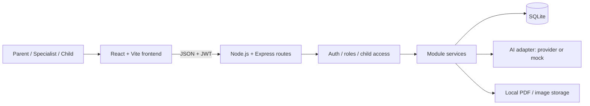
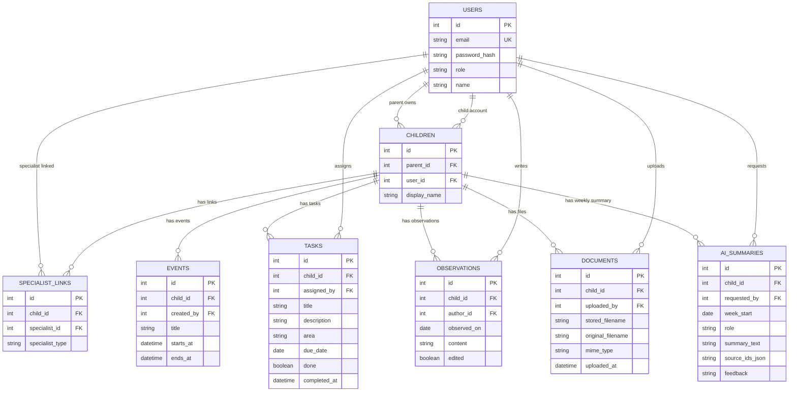
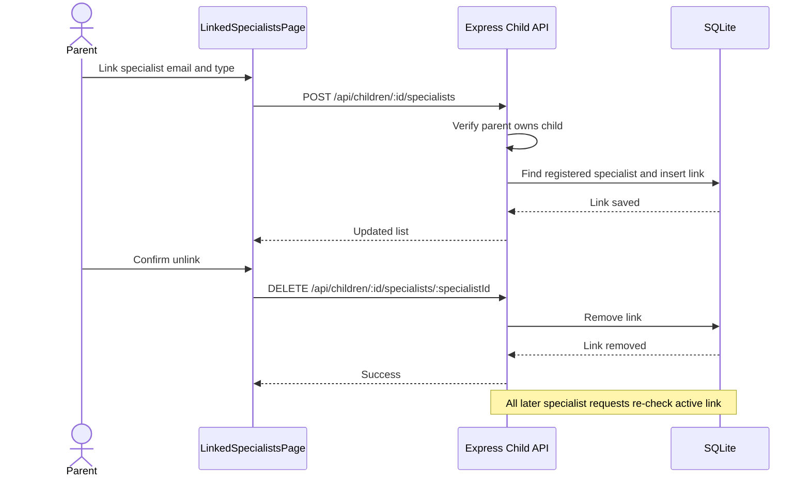
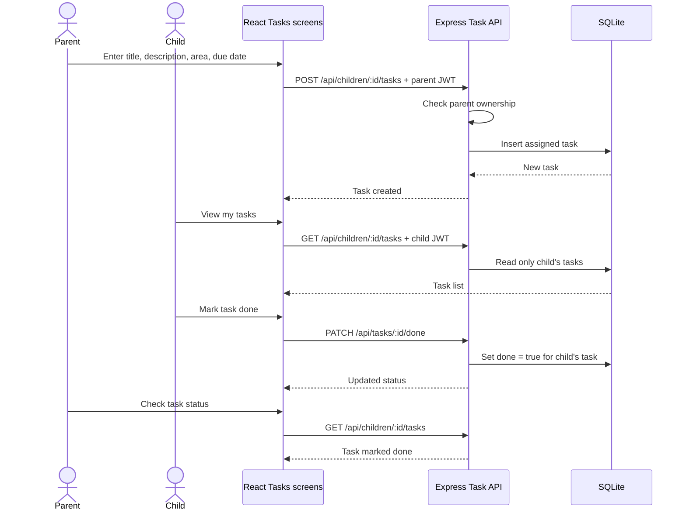
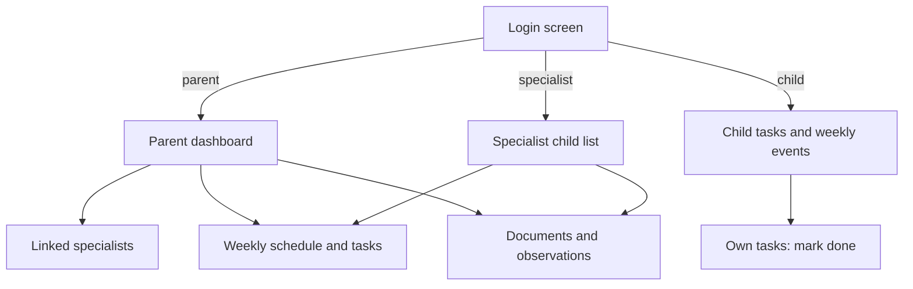

# Software Design Document (SDD)

**Team name:** Hexagon  
**Version:** First detailed version (Week 6); final revision planned Week 10  
**Last updated:** 2026-11-07  
**Project:** AI-Assisted Child Development Platform

> Design for M1–M8. The `v0.0` tag contains the original synthetic walking skeleton. As of 2026-11-07, the `main` branch also contains initial M1–M4 code; those modules are not yet a tagged `v0.1` release. M5–M8 are still planned.

## 1. Architecture Overview

The application uses a simple client-server structure. A React/Vite frontend calls an Express REST API; the backend applies authentication and child-specific authorization before reading or writing SQLite data. An AI service adapter will call the chosen provider (Gemini or GitHub Models) or a deterministic mock for tests and CI.



### Technology Stack

| Layer | Technology |
|---|---|
| Frontend | React + Vite, JavaScript |
| Backend | Node.js + Express, REST JSON |
| Database | SQLite using better-sqlite3 |
| Authentication | JWT; passwords hashed with bcrypt |
| AI | Gemini API or GitHub Models through one backend adapter; mandatory mock mode |
| Testing | Jest + Supertest (API), Vitest (frontend), Playwright (E2E) |
| CI | GitHub Actions |
| Deployment | Local only via README; no Docker/cloud deployment |

### Proposed project structure

```text
frontend/src/
  pages/       # Login, Parent, Specialist and Child screens
  components/  # Week view, task list, observations, documents
backend/src/
  routes/      # REST endpoints
  middleware/  # JWT and per-child access enforcement
  services/    # M1-M8 business logic and AI adapter
  db.js        # SQLite connection and schema
  seed.js      # Synthetic accounts and project data
backend/uploads/   # Local PDF/image files (gitignored)
docs/
  SRS.md  SDD.md  PMP.md  img/
e2e/            # Browser tests
```

This directory tree is the intended layered structure. The current student-sized implementation groups M2–M4 endpoints in `backend/src/modules.js` and renders their basic forms in `frontend/src/Workspace.jsx`; more separation may follow.

## 2. Module Design

| Module | Main planned components | Implements requirements |
|---|---|---|
| M1 Login and Roles | LoginPage, RoleNavigation, authRoutes, authMiddleware, accessControl | FR-M1-01–FR-M1-06 |
| M2 Specialist Links | LinkedSpecialistsPage, specialistLinkRoutes, childAccessService | FR-M2-01–FR-M2-05 |
| M3 Weekly Schedule | WeeklySchedulePage, EventForm, eventRoutes | FR-M3-01–FR-M3-03 |
| M4 Tasks | AssignTaskForm, ChildTasksPage, taskRoutes, taskService | FR-M4-01–FR-M4-05 |
| M5 Specialist Entries | ObservationForm, ObservationList, observationRoutes | FR-M5-01–FR-M5-04 |
| M6 Documents | DocumentUpload, DocumentList, documentRoutes, fileStorageService | FR-M6-01–FR-M6-04 |
| M7 Weekly Statistics | WeeklyStatisticsPage, statisticsRoutes, statisticsService | FR-M7-01–FR-M7-03 |
| M8 AI Summary | WeeklySummaryPanel, summaryRoutes, aiProviderService, mockAIProvider | FR-M8-01–FR-M8-07 |

### Shared authorization rule

For any endpoint using a child ID, the backend must check:

- **Parent:** the child's `parent_id` equals the authenticated user ID.
- **Specialist:** an active row exists in `specialist_links` for that specialist and child.
- **Child:** the child's `user_id` equals the authenticated user ID, **and** only own schedule/tasks endpoints are available.
- No role is trusted from request body fields; role comes from the verified JWT/account.

Unlinking a specialist revokes subsequent access without changing or copying old records.

## 3. Data Model

The following is the intended normalized SQLite design. IDs are internal synthetic record IDs.



**Constraints:** `users.email` is unique; `specialist_links(child_id, specialist_id)` is unique. Use foreign keys and indexes on `child_id`, date/week and assignee fields. Stored document filenames are generated, never directly taken from user input. The role is restricted to `parent`, `specialist`, `child`. Seed data must be synthetic.

**Implementation status:** The `v0.0` tag has only `demo_tasks`. Current `main` additionally contains `users`, `children`, `specialist_links`, `events` and `tasks`; the observations, documents and AI summary tables remain a design for M5–M8.

## 4. API / Interfaces

Paths below are the API design contract. M1–M4 endpoints have initial implementations on current `main` with JWT and child-specific access checks; M5–M8 endpoints are planned, not implemented.

| Method | Endpoint | Description / authorized user | Module |
|---|---|---|---|
| POST | /api/auth/login | Email/password to JWT; all registered users | M1 |
| GET | /api/auth/me | Authenticated account and stored role | M1 |
| GET | /api/children/:childId/specialists | List links; owning parent | M2 |
| POST | /api/children/:childId/specialists | Link registered specialist by email/type; owning parent | M2 |
| DELETE | /api/children/:childId/specialists/:specialistId | Unlink; owning parent | M2 |
| GET | /api/children/:childId/events?week=YYYY-MM-DD | Weekly events; allowed parent/specialist/child | M3 |
| POST | /api/children/:childId/events | Create event; parent/linked specialist | M3 |
| GET | /api/children/:childId/tasks | List assigned tasks; scoped to role | M4 |
| POST | /api/children/:childId/tasks | Assign task; parent/linked specialist | M4 |
| PATCH | /api/tasks/:taskId/done | Mark own assigned task done; child | M4 |
| GET | /api/children/:childId/observations | List observations; parent/linked specialist | M5 |
| POST | /api/children/:childId/observations | Create dated observation; linked specialist | M5 |
| PATCH | /api/observations/:entryId | Edit own observation, set edited flag | M5 |
| GET | /api/children/:childId/documents | List document metadata; parent/linked specialist | M6 |
| POST | /api/children/:childId/documents | Upload PDF/image; parent/linked specialist | M6 |
| GET | /api/documents/:id/download | Permission-checked download; no public upload URL | M6 |
| GET | /api/children/:childId/statistics?week=YYYY-MM-DD | Overall and per-area completion | M7 |
| POST | /api/children/:childId/summary | Safe role-based AI summary with source IDs | M8 |
| POST | /api/summaries/:id/feedback | Record helpful/incorrect feedback from viewer | M8 |

**Legacy v0.0 endpoints retained:** `GET /api/health`, `GET /api/demo-tasks`, `POST /api/demo-tasks`. They are public synthetic learning demos, separate from the new protected M1–M4 endpoints. `GET /api/children` also lists role-scoped child records.

**Errors:** 400 invalid input; 401 missing/invalid JWT; 403 forbidden role or link; 404 unknown record (or masked unauthorized lookup); 409 duplicate link; 500 unexpected server error. API responses are JSON, except protected binary document downloads.

## 5. Critical Flows

These correspond exactly to SRS Section 4.

### Flow 1: Login and role access

```mermaid
sequenceDiagram
  actor User
  participant UI as React LoginPage
  participant API as Express Auth API
  participant DB as SQLite
  User->>UI: Enter email and password
  UI->>API: POST /api/auth/login
  API->>DB: Find account by email
  DB-->>API: Role and password hash
  API->>API: Check password; sign JWT
  API-->>UI: JWT + stored role
  UI-->>User: Show permitted role navigation
  User->>UI: Open protected page
  UI->>API: API request with JWT
  API->>API: Validate JWT and permission
  API-->>UI: Allowed data or 401/403
```

### Flow 2: Parent links and unlinks a specialist



### Flow 3: Parent assigns a task; child finishes it



## 6. User Interface

The following are **wireframe sketches**, not screenshots of completed screens. The real UI will be implemented in later module PRs.

| Screen | Sketch / planned main elements | Module |
|---|---|---|
| Login | Email, password, Log in; no role picker | M1 |
| Parent dashboard | Child selection, weekly schedule, assigned tasks, recent entries, statistics and AI summary | M1, M3–M8 |
| Linked specialists | Email/type link form, current specialists, confirmed Unlink action | M2 |
| Child dashboard | My weekly events, My tasks, Mark done | M3, M4 |
| Specialist child profile | Linked child list, weekly schedule, assign task, observations, documents, AI summary | M2–M6, M8 |
| Documents | Upload, filename/type/uploader/date list, permission-protected download | M6 |



The current Week 5 demo UI can be reviewed in `frontend/src/main.jsx`. Add actual screenshots to `docs/img/` only after implementing the screens.

## 7. Change Log

| Date | Change | By |
|---|---|---|
| 2026-10-25 | Initial architecture outline | Team |
| 2026-11-07 | Expanded architecture, module mapping, ER model, API contract, three flows and UI wireframes | Team draft via coding assistant; pending team review |

**Design boundaries:** No sign-up/invitation service, no admin panel, no mobile app, no cloud deployment, no diagnosis/treatment output, and no real child data.
