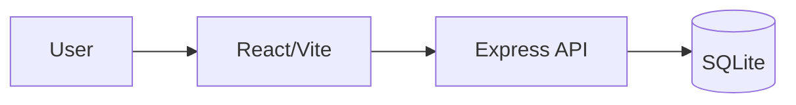

# Software Design Document (SDD)

**Team name:** Hexagon
**Version:** First version (Week 6) — draft in progress
**Last updated:** 2026-10-25

This is an initial outline, not the final design. Complete it in Week 6 using the actual SRS requirement IDs.

## 1. Architecture Overview

## 2. Module Design
Map M1–M8 to SRS FR identifiers.

## 3. Data Model
Expand the ER diagram for real roles, children, tasks, observations and documents.

## 4. API / Interfaces
Add all implemented endpoints.

## 5. Critical Flows
Use the same three flows as SRS, with sequence diagrams.

## 6. User Interface
Add real sketches/screenshots to docs/img/.

## 7. Change Log
| Date | Change | By |
|---|---|---|
| 2026-10-25 | Initial outline | Team |
