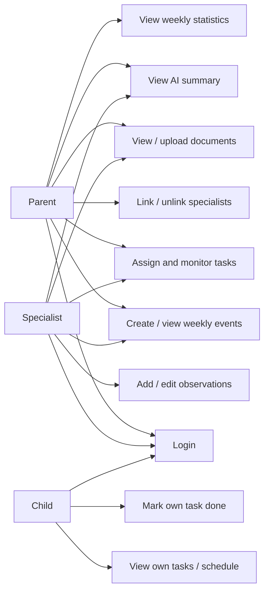

# Software Requirements Specification (SRS)

**Team name:** Hexagon  
**Version:** First detailed version (Week 6); planned final review Week 10  
**Last updated:** 2026-11-07  
**Project:** AI-Assisted Child Development Platform

## 1. Introduction

### Purpose
The platform lets parents and their linked specialists organize a child's weekly events, tasks, observations and documents in one place. A child sees their own tasks and schedule, while an AI feature may summarize permitted records for a parent or specialist; it never makes medical decisions.

### Users

| User type | Description |
|---|---|
| Parent | Owns their child's data; manages specialist links, tasks, events and records |
| Specialist | A registered teacher, psychologist, doctor, special education teacher or coach; accesses only linked children |
| Child | Uses their own account to view schedule/tasks and mark assigned tasks complete |

Users are created using **synthetic seed data** in the semester project. No public registration, real child data, or email invitations are included.

## 2. Functional Requirements

All eight modules are required by the term assignment and therefore have **Must** priority. Requirements are numbered permanently for Jira tasks and tests.

### M1 – Login and Roles

| ID | Requirement | Priority |
|---|---|---|
| FR-M1-01 | The system shall let registered users log in with email and password and return a JWT on valid credentials. | Must |
| FR-M1-02 | The system shall reject invalid credentials without issuing a JWT. | Must |
| FR-M1-03 | The system shall determine the user role from the stored account, not from a role selected by the user. | Must |
| FR-M1-04 | The system shall show parent, specialist and child navigation according to the authenticated user's role. | Must |
| FR-M1-05 | The API shall reject requests with missing, invalid or expired JWTs to protected endpoints. | Must |
| FR-M1-06 | The API shall enforce role permissions and restrict access to the user's own or explicitly linked child data. | Must |

### M2 – Linking Specialists

| ID | Requirement | Priority |
|---|---|---|
| FR-M2-01 | The system shall let a parent link an existing registered specialist to a child by specialist email and specialist type. | Must |
| FR-M2-02 | The system shall show a child's currently linked specialists to the parent. | Must |
| FR-M2-03 | The system shall let the parent unlink a specialist from a child after a confirmation step. | Must |
| FR-M2-04 | The system shall show an error when a parent tries to link an unregistered email or non-specialist account. | Must |
| FR-M2-05 | The API shall immediately reject all child-data requests from an unlinked specialist. | Must |

### M3 – Weekly Schedule

| ID | Requirement | Priority |
|---|---|---|
| FR-M3-01 | The system shall let the parent and currently linked specialists create dated events for a child. | Must |
| FR-M3-02 | The system shall list a child's events for a selected seven-day week. | Must |
| FR-M3-03 | The system shall show a child only their own schedule, without access to other children's events. | Must |

### M4 – Tasks

| ID | Requirement | Priority |
|---|---|---|
| FR-M4-01 | The system shall let the parent and currently linked specialists assign tasks to a child with title, description, development area and due date. | Must |
| FR-M4-02 | The system shall let the child list only tasks assigned to that child. | Must |
| FR-M4-03 | The system shall let the child mark one of their own tasks as done. | Must |
| FR-M4-04 | The system shall let the task assigner see the task's completion status. | Must |
| FR-M4-05 | The API shall reject assigning tasks to or marking tasks for a child outside the user's permissions. | Must |

### M5 – Specialist Entries

| ID | Requirement | Priority |
|---|---|---|
| FR-M5-01 | The system shall let currently linked specialists create dated observation entries for a child. | Must |
| FR-M5-02 | The system shall show entries to the child's parent and currently linked specialists. | Must |
| FR-M5-03 | The system shall mark an entry as "edited" when its author edits the content after creation. | Must |
| FR-M5-04 | The API shall prevent child accounts from reading specialist entries. | Must |

### M6 – Documents

| ID | Requirement | Priority |
|---|---|---|
| FR-M6-01 | The system shall let authorized parents and currently linked specialists upload PDF or image files for a child. | Must |
| FR-M6-02 | The system shall list each document's name, file type, uploader and upload date to authorized viewers. | Must |
| FR-M6-03 | The system shall let authorized viewers view or download a document. | Must |
| FR-M6-04 | The API shall prevent child accounts and unlinked specialists from accessing document files or metadata. | Must |

### M7 – Weekly Statistics

| ID | Requirement | Priority |
|---|---|---|
| FR-M7-01 | The system shall calculate the total percentage of tasks marked done in a selected week. | Must |
| FR-M7-02 | The system shall calculate completion percentages separately for each development area in that week. | Must |
| FR-M7-03 | The system shall show weekly statistics only to users allowed to access the associated child's records. | Must |

### M8 – Role-Based AI Summary

| ID | Requirement | Priority |
|---|---|---|
| FR-M8-01 | The backend shall generate a weekly summary from permitted records using a single AI-provider module with a mock mode for tests and CI. | Must |
| FR-M8-02 | The system shall use different role-specific prompts for parents and specialists. | Must |
| FR-M8-03 | The system shall label every AI summary clearly as "AI-generated". | Must |
| FR-M8-04 | The system shall show source record references for the information in an AI summary. | Must |
| FR-M8-05 | The backend shall send only records the requesting user is allowed to see to the AI provider. | Must |
| FR-M8-06 | The system shall present AI output as suggestions or summaries only, with no diagnosis, treatment or automatic decisions. | Must |
| FR-M8-07 | The interface shall let the reader give helpful/incorrect feedback on the summary. | Must |

## 3. Non-Functional Requirements

| ID | Category | Requirement |
|---|---|---|
| NFR-01 | Performance | With a local seeded database of up to 100 synthetic tasks, the weekly task list API shall respond in under 2 seconds in at least 9 of 10 local test requests. |
| NFR-02 | Security | Passwords shall be stored as salted one-way hashes, not plaintext, and protected endpoints shall require a valid JWT. |
| NFR-03 | Authorization | An automated API test shall confirm that an unlinked specialist and an unrelated child receive HTTP 403 (or HTTP 404 without leaking data) for another child's protected resources. |
| NFR-04 | Reliability | The GitHub Actions CI shall run Jest/Supertest backend tests, Vitest frontend tests, and a Playwright end-to-end flow; failed tests shall fail the CI job. |
| NFR-05 | Privacy | Test, demonstration, seed and AI input data shall be synthetic; no real children's personal or medical data shall be stored or sent to an AI provider. |

These are measurable project targets and will be checked as functionality is implemented. They are not claims that all requirements already pass.

## 4. Critical Flows and Acceptance Criteria

These same three flows are used in the SDD sequence diagrams and planned Playwright tests.

| Flow | Related requirements | Acceptance criteria |
|---|---|---|
| **Flow 1: Login and role access** | FR-M1-01, FR-M1-03, FR-M1-04, FR-M1-05 | **Given** a seeded parent account, **When** the parent logs in with correct credentials, **Then** the system opens the parent view using the account's role; **When** a protected request has no JWT, **Then** it is rejected. |
| **Flow 2: Link then unlink a specialist** | FR-M2-01, FR-M2-02, FR-M2-03, FR-M2-05 | **Given** a registered specialist not linked to a parent's child, **When** the parent links that specialist by email, **Then** the specialist can view that child's permitted records; **When** the parent unlinks them, **Then** subsequent API access is rejected. |
| **Flow 3: Assign and finish a task** | FR-M4-01, FR-M4-02, FR-M4-03, FR-M4-04 | **Given** a parent and their child, **When** the parent assigns a task with the required fields, **Then** the child sees it; **When** the child marks it done, **Then** its assigner sees the done status. |

## 5. Use Case Diagram (optional)

## 6. Change Log

| Date | Change | By |
|---|---|---|
| 2026-10-25 | Initial outline for Week 5 skeleton | Team |
| 2026-11-07 | Expanded M1–M8 functional requirements, NFRs, and critical acceptance flows from the course assignment | Team draft via coding assistant; pending team review |

**Status note:** This is a requirements document, not an assertion that M1–M8 are already implemented. The v0.0 demo task API is an initial technical proof only.
